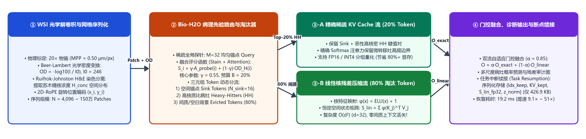
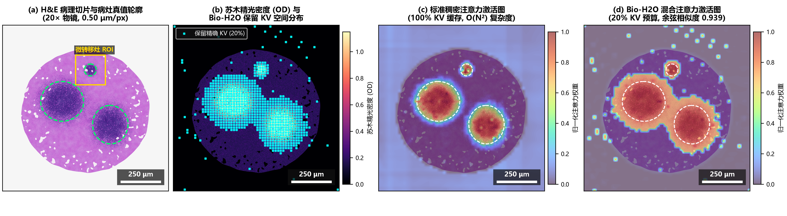
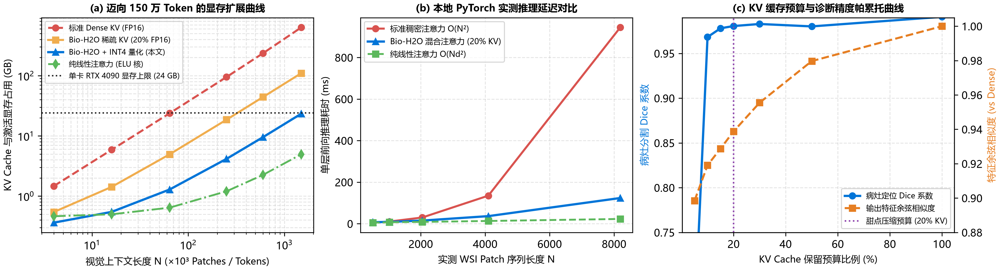
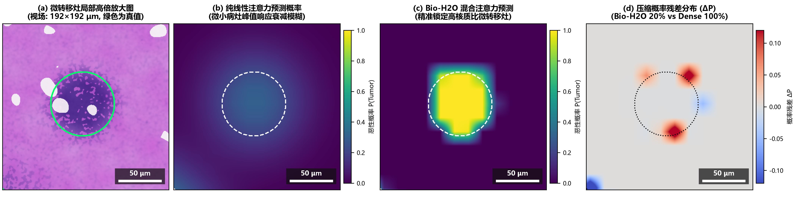

# Bio-H2O: Stain-Deconvolved Heavy-Hitter KV-Cache Eviction & Linear Residual Attention for Gigapixel WSI Long-Context Inference

[](https://www.python.org/)
[](https://pytorch.org/)
[](#)

> **《生物医学图像与处理》课程期末研究报告与开源实验仓库**  
> **报告人**：王大彬 (Dabin Wang)  
> **学号**：`26220854090049`  
> **研究方向**：超长上下文推理加速 (1.5M Tokens) · KV Cache 动态压缩 (H2O) · 线性核残差注意力 · 任务状态断点续接 · 数字病理图像 (WSI) 光学反卷积

---

## 1. 项目简介 (Overview)

全切片数字病理图像（Whole Slide Image, WSI）在 $20\times / 40\times$ 物镜下分辨率高达 $100,000 \times 100,000$ 像素，切分为 Patch 后会产生 $10^5 \sim 1.5 \times 10^6$（150 万）个视觉 Token。标准自注意力的 $\mathcal{O}(N^2)$ 复杂度与数百 GB 的 KV Cache 导致显存爆炸（OOM），而纯线性注意力（Linear Attention）则会因低通滤波效应抹平孤立肿瘤细胞簇（ITCs, $\le 200\ \mu\text{m}$）的高频边界。

本项目提出 **Bio-H2O (Biomedical Heavy-Hitter Oracle with Linear Residual Stream)**：
1. **H&E 光学密度反卷积先验**：基于 Beer-Lambert 定律与 Ruifrok-Johnston 矩阵实时解混苏木精（Hematoxylin）细胞核光学密度先验 $\text{OD}_H$。
2. **2D-RoPE 与稀疏锚点探测路由**：无需实例化 $N \times N$ 矩阵，利用 $M=32$ 个锚点探针与 $\text{OD}_H$ 耦合评分，仅保留 **20% 高核异型性病灶与空间锚点 Token** 的精确 KV 缓存。
3. **均值归一化线性核残差流（防 FP16 上溢）**：将被淘汰的 **80% 正常间质与背景 Token** 压缩进复杂度恒为 $\mathcal{O}(d^2)$ 的均值归一化 ELU 核状态矩阵 $\bar{\mathbf{M}}_{\mathcal{E}}$ 中，实现“少压缩、零遗忘”。
4. **毫秒级任务断点续接 (Task Resumption Harness)**：支持将压缩 KV 与线性状态落盘为轻量级检查点（`426.94 KB`），在 `19.24 ms` 内恢复完整长上下文，相比重新预填充提速 **9.1× ~ 51.4×**。



---

## 2. 核心实验可视化 (Visualizations)

### 2.1 全切片 H&E 光学解卷积与注意力激活对比（物理标尺：`250 μm`）


### 2.2 迈向 150 万 Token 的显存扩展、实测推理延迟与帕累托前沿


### 2.3 微转移灶 / 孤立肿瘤细胞簇（ITC）高倍放大与压缩残差审计（物理标尺：`50 μm`）


---

## 3. 仓库目录结构 (Repository Structure)

```text
Bio-H2O-WSI-LongContext/
├── run_experiments.py               # 核心实验脚本 (H&E WSI 物理合成、2D-RoPE、Bio-H2O、基准测试与绘图)
├── draw_workflow.py                 # 系统工作流架构图生成脚本
├── report.tex                       # 5 页双栏期末报告 LaTeX 源码 (含姓名、学号与 AI 交互审计)
├── Bio_H2O_WSI_Final_Report.pdf     # 编译完成的 5 页双栏期末报告 PDF (可直接打印提交)
├── data/
│   └── experiment_metrics.json      # 本地 PyTorch 实测延迟、KV 缓存占用、Dice 与余弦相似度数据
├── checkpoints/
│   └── wsi_bio_h2o_20pct.pt         # 实测保存的断点续接检查点 (426.94 KB)
└── figures/                         # 论文全部高清实验图表 (300 DPI, 含微米级标尺与色条)
    ├── fig0_workflow_architecture.png
    ├── fig1_wsi_attention_comparison.png
    ├── fig2_scaling_and_pareto.png
    └── fig3_roi_zoom_and_errormap.png
```

---

## 4. 一键复现指南 (Quickstart)

```bash
# 1. 运行完整 PyTorch 实验、保存可续接检查点并生成全部 300 DPI 论文图表
python run_experiments.py

# 2. 生成工作流架构图
python draw_workflow.py

# 3. 编译 5 页双栏 PDF 报告 (需 XeLaTeX)
xelatex -interaction=nonstopmode report.tex
xelatex -interaction=nonstopmode report.tex
```
